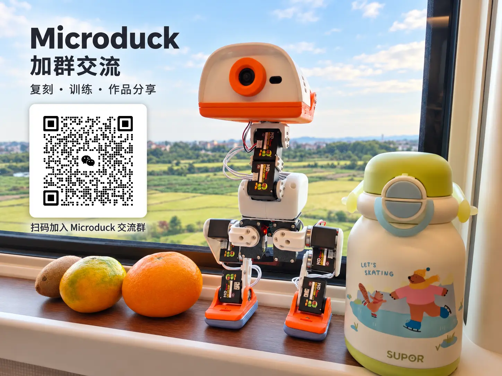

[简体中文](README.md) | **English**

# 🦆 Microduck Feetech HD1910 Replica · Build, control and reinforcement learning

From a collection of parts to a walking, forward-rolling robot duck—and then to training your own movements. This working Feetech HD1910 replica of [Pollen Robotics Microduck](https://github.com/pollen-robotics/microduck) brings together a **system image, two Chinese-language consoles, DIY HAT / IMU boards and complete 3D printing files**, covering parts, building, control and reinforcement learning.

[🚀 Complete build guide](docs/MICRODUCK-BUILD-GUIDE.en.md) · [📥 Downloads](#downloads-and-versions) · [❓ FAQ](docs/MICRODUCK-FAQ.en.md) · [🌐 Online guides](https://kissqy.github.io/Microduck-kissqy/guides/en.html)

<table align="center">
  <tr>
    <td align="center" valign="top">
      <b>💬 Join the WeChat group</b>  
       
      Valid before November 1, 2026 · Click the image for full size · <a href="docs/assets/community-wechat-qr.png">QR code only</a>
    </td>
  </tr>
</table>

## 🎬 See the duck in action — 7 real-robot videos

<table>
<tr>
      <td width="10%"><video src="https://github.com/user-attachments/assets/0ec5b46b-1ec0-483a-a95d-3b3f307e155f" controls></video></td>
   <td width="10%"><video src="https://github.com/user-attachments/assets/71fc2c95-8499-49f6-924b-837df42814cf" controls></video></td>
  <td width="10%"><video src="https://github.com/user-attachments/assets/d09a6bfe-7a28-4266-ba90-de2b331472ad" controls></video></td>
  <td width="10%"><video src="https://github.com/user-attachments/assets/a604c0e0-af01-413f-ab00-99ccd26db8d5" controls></video></td>
  <td width="10%"><video src="https://github.com/user-attachments/assets/4508d91c-e91c-40f4-8c3e-5ca5a3f959c3" controls></video></td>
  <td width="10%"><video src="https://github.com/user-attachments/assets/fd0dfafd-dd02-4852-940c-33706c287e9d" controls></video></td>
  <td width="10%"><video src="https://github.com/user-attachments/assets/693a3272-d814-42f6-86b3-be5cb3b35b0f" controls></video></td>
</tr>
</table>

These clips show the real robot. The console demos below use simulated data; they cannot connect to a robot or run training.

## ✨ Walk, roll and train new movements

This little duck can **walk, sit, pick things up, kick a ball, and roll forward**. Add rollers to explore **swizzling, crouching, spinning, and standing up after a fall**. Use a physical gamepad to control it; an independent Training Studio is available when you want to train your own movements.

**System Image R1 has passed a fresh-card installation test.** It includes the official system, this project's robot services and motion models. Flash it onto a Radxa ZERO 3W, connect to Wi-Fi, and open the console without compiling firmware from source.

## 🧭 Start with your goal

| Your goal | Go here |
| --- | --- |
| Build a Microduck with Feetech servos | [Parts to first walking](docs/MICRODUCK-BUILD-GUIDE.en.md) · [Parts and budget](DUCK-SHOPPING-LIST.en.md) |
| Flash, calibrate and operate an assembled duck | [V167 user guide](microduck-hd1910/firmware/console/USER-GUIDE.en.md) |
| Train walking, recovery or your own movements | [Training Studio R1.5.27](microduck-hd1910/training-console/USER-GUIDE.en.md) |
| Build HAT and a separate IMU | [Hardware projects and build guides](hardware/README.en.md) |
| Explore the source or full documentation | [Source](microduck-hd1910/README.en.md) · [All guides](docs/README.en.md) |
| Troubleshoot network, reboot, IMU or calibration | [FAQ and troubleshooting links](docs/MICRODUCK-FAQ.en.md) |

## 🚀 Start in three steps

1. **Build the duck** — Follow the guide to buy parts, print the structure and assemble the robot.
2. **Flash and connect** — Use the provided system image, follow the Wi-Fi setup wizard and connect with Robot Console.
3. **Calibrate and explore** — Calibrate the robot and try its existing movements; use Training Studio when you want to train your own models.

**[Follow the complete guide from parts to first walking →](docs/MICRODUCK-BUILD-GUIDE.en.md)**

  
  
First-boot Wi-Fi setup preview. The actual screen is the one shipped with Public Image R1.

## Downloads and versions

| Package | Purpose | Download |
| --- | --- | --- |
| **System Image R1** | First installation; robot services and movement models included | [⬇️ .img.xz](https://github.com/kissqy/Microduck-kissqy/releases/download/public-image-r1/microduck-zero3w-0.15.1-R1.img.xz) |
| **Robot Console R17 V167** | Connect, calibrate and control the robot; maintain its firmware | [⬇️ ZIP](https://github.com/kissqy/Microduck-kissqy/raw/refs/heads/main/release-assets/Microduck-Console-R17-V167.zip) |
| **Training Studio R1.5.27** | Train, evaluate, and export your own models | [⬇️ ZIP](https://github.com/kissqy/Microduck-kissqy/raw/refs/heads/main/release-assets/Microduck-Training-Studio-R1.5.27.zip) |
| **Robot firmware** | Upgrade an existing installation | [⬇️ .tar.gz](https://github.com/kissqy/Microduck-kissqy/raw/refs/heads/main/microduck-hd1910/firmware/console/updates/Microduck-Robotd-FT6-R17.tar.gz) |
| **IMU firmware** | Flash a DIY IMU board | [⬇️ .bin](https://github.com/kissqy/Microduck-kissqy/raw/refs/heads/main/microduck-hd1910/firmware/console/updates/imu_to_feetech_ReVA_FT6_SYNC15_UART_IRQ_v1.bin) · [Flashing guide](hardware/IMU-FIRMWARE.en.md) |
| **Complete printing set · FrankenDuck** | Complete structural models and reference plate layouts | [⬇️ RAR](https://github.com/kissqy/Microduck-kissqy/raw/refs/heads/main/hardware/3d-print-frankenduck/Microduck-Print-FrankenDuck-20261015.rar) · [Guide](hardware/3d-print-frankenduck/README.en.md) |

**For a first build, download the system image and Robot Console; Training Studio is optional.** Installation, firmware upgrades and IMU flashing are covered in the linked guides.

[Firmware downloads and installation](release-assets/README.en.md) · [System image guide](docs/releases/public-image-r1.en.md) · [IMU flashing guide](hardware/IMU-FIRMWARE.en.md)

## 🎮 Two consoles, two jobs

| 🐣 Robot Console · R17 V167 · [Demo](https://kissqy.github.io/Microduck-kissqy/) | 🧠 Training Studio · R1.5.27 · [Demo](https://kissqy.github.io/Microduck-kissqy/training/) |
| --- | --- |
| Live 3D pose, camera, joint / IMU data, servo calibration | Training tasks, recipes, queue, progress and reward curves |
| Physical gamepad control, firmware maintenance, model status | Visual simulation, policy evaluation, ONNX export |
| Prepared image and firmware to simplify setup | Start with existing movements and explore your own models |

Try the included motion models on the real robot, then explore reinforcement learning at your own pace. The videos above show recorded real-robot results.

The released interfaces are Chinese. English guides above retain the original button labels where needed; see also the [source and build guides](microduck-hd1910/README.en.md).

## 🖨️ Complete printing set · FrankenDuck

Community improvements and the author's real-robot modifications are collected into a **complete set of structural models and reference plate layouts**. Explore standard feet and roller setups, from printing and assembly to a working robot.

[Printing files, plate previews and assembly notes →](hardware/3d-print-frankenduck/README.en.md)

## 🔧 DIY HAT and IMU

The DIY HAT and independent torso IMU have been used extensively on the author's robot. **PCB projects, parts lists and complete build records** let you make your own boards or choose the author's assembled version.

[Hardware projects and build guides](hardware/README.en.md) · [IMU build video](https://www.bilibili.com/video/BV1qapz6PERs/) · [Buy assembled boards](https://item.taobao.com/item.htm?id=1095121548583)

## ❤️ Sharing the project and crediting its creators

This is an individual replica and development project based on the official Microduck, with AI-assisted programming. I hope these materials help you get your own duck moving sooner. Stars ⭐, discussion and feedback are welcome. [The author's learning journey](docs/AUTHOR-JOURNEY.en.md)

Original work the author owns and can license is for personal learning, research and noncommercial use; commercial use requires written permission. Upstream and third-party content retain their own licenses. [Component licenses](microduck-hd1910/LICENSE) · [Personal noncommercial terms](microduck-hd1910/LICENSES/Personal-NonCommercial.txt) · [Third-party credits](microduck-hd1910/docs/THIRD-PARTY.en.md)

<table align="center">
  <tr>
    <td align="center" valign="top" width="50%">
      <b>❤️ Support the author</b>  
      
    </td>
    <td align="center" valign="top" width="50%">
      <b>💬 Contact the author</b>  
       
      Scan in WeChat to contact the author. Click the QR code for the original image.
    </td>
  </tr>
</table>
