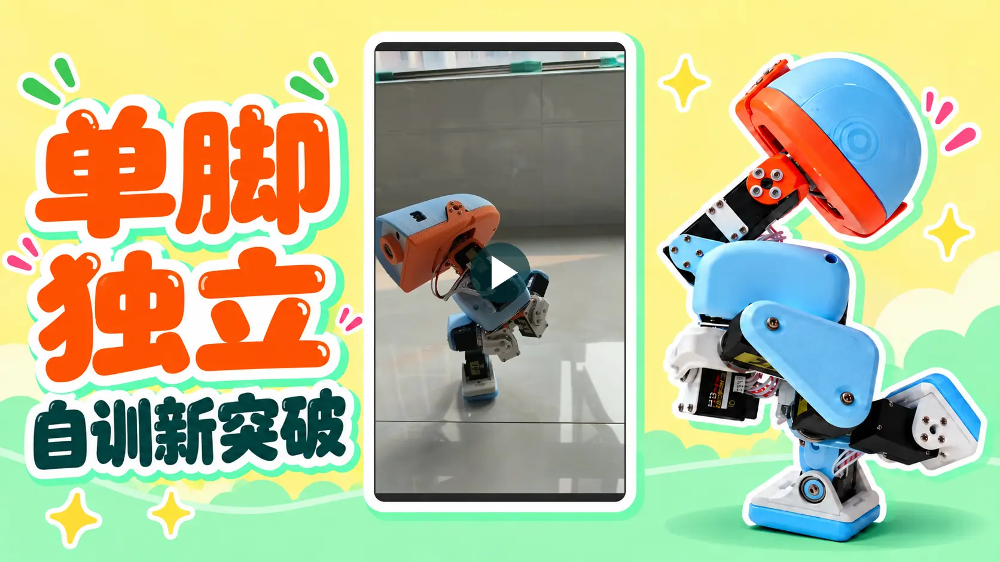

**简体中文** | [English](README.en.md)

# 🦆 Microduck 飞特 HD1910 复刻 · 中文中控、强化学习训练与自制硬件

从零件到一只会走路、会翻跟头的小鸭，再到训练属于自己的动作。基于 [Pollen Robotics Microduck](https://github.com/pollen-robotics/microduck) 完成飞特 HD1910 实机复刻，提供**系统镜像、两套中文中控、自制 HAT／IMU 和全套 3D 打印件**，把采购、制作、操作与强化学习训练串成一套完整流程。

[🚀 从零复刻教程](docs/MICRODUCK-BUILD-GUIDE.md) · [📥 下载](#下载与版本) · [❓ 常见问题](docs/MICRODUCK-FAQ.md) · [🌐 在线教程](https://kissqy.github.io/Microduck-kissqy/guides/)

## 🏆 单脚独立 · 自训新突破

<table align="center">
  <tr>
    <td align="center" valign="top">
      <b>💬 加群交流</b>  
       
      2026 年 11 月 1 日前有效 · 点击图片查看大图 · <a href="docs/assets/community-wechat-qr.png">单独二维码</a>
    </td>
  </tr>
</table>

## 🎬 更多实机视频

<table>
<tr>
  <td width="10%"><video src="https://github.com/user-attachments/assets/0ec5b46b-1ec0-483a-a95d-3b3f307e155f" controls></video></td>
  <td width="10%"><video src="https://github.com/user-attachments/assets/d09a6bfe-7a28-4266-ba90-de2b331472ad" controls></video></td>
  <td width="10%"><video src="https://github.com/user-attachments/assets/a604c0e0-af01-413f-ab00-99ccd26db8d5" controls></video></td>
  <td width="10%"><video src="https://github.com/user-attachments/assets/4508d91c-e91c-40f4-8c3e-5ca5a3f959c3" controls></video></td>
  <td width="10%"><video src="https://github.com/user-attachments/assets/fd0dfafd-dd02-4852-940c-33706c287e9d" controls></video></td>
  <td width="10%"><video src="https://github.com/user-attachments/assets/693a3272-d814-42f6-86b3-be5cb3b35b0f" controls></video></td>
</tr>
</table>

[🎬 查看全部实机视频 →](https://kissqy.github.io/Microduck-kissqy/one-leg-balance.html#more-videos)

以上为实机视频；下方中控在线演示使用模拟数据，不连接实机或真正训练。

## ✨ 会走、会翻，还能训练新动作

这是一只会**走路、坐下、捡东西、踢球、前滚翻**的小鸭。装上滑轮，还能探索**对称滑行、蹲下、原地转和倒地起身**等动作。实体手柄就能控制，不必为了每个动作打开电脑点按钮；想训练自己的动作，还有独立训练中控。

**系统镜像 R1 已通过刷卡实测**，预装官方系统、本项目机器人服务和运动模型。刷入 Radxa ZERO 3W、连接 Wi-Fi 后即可打开中文中控，无须自行编译固件。

## 🧭 从你要做的事情开始

| 你的目标 | 直接入口 |
| --- | --- |
| 想自己做一只 Microduck 飞特版 | [从采购到第一次行走](docs/MICRODUCK-BUILD-GUIDE.md) · [材料与预算](DUCK-SHOPPING-LIST.md) |
| 已经装好，准备刷机、标定和操作 | [V167 使用指南](microduck-hd1910/firmware/console/README.zh-CN.md) |
| 想训练行走、起身或自己的动作 | [训练中控 R1.5.27](microduck-hd1910/training-console/README.zh-CN.md) |
| 想制作 HAT 或独立 IMU | [硬件工程与制作说明](hardware/README.md) |
| 想看源码或查完整文档 | [源码入口](microduck-hd1910/README.md) · [全部文档](docs/README.md) |
| 遇到断网、重启、IMU 或标定问题 | [常见问题与排查入口](docs/MICRODUCK-FAQ.md) |

## 🚀 三步开始

1. **准备鸭子** — 按教程采购零件、打印结构件并完成装配。
2. **刷机连接** — 使用配套系统镜像，按中文向导完成配网，再用机器人中控连接。
3. **标定开玩** — 完成标定后体验现成动作；想探索更多，再用训练中控训练自己的模型。

**[查看从采购到第一次行走的完整教程 →](docs/MICRODUCK-BUILD-GUIDE.md)**

  
  
首次热点配网页面

## 下载与版本

| 文件 | 用途 | 下载 |
| --- | --- | --- |
| **系统镜像 R1** | 首次刷机，预装机器人服务与运动模型 | [⬇️ .img.xz](https://github.com/kissqy/Microduck-kissqy/releases/download/public-image-r1/microduck-zero3w-0.15.1-R1.img.xz) |
| **机器人中控 R17 V167** | 连接、标定、操作鸭子与维护固件 | [⬇️ ZIP](https://github.com/kissqy/Microduck-kissqy/raw/refs/heads/main/release-assets/Microduck-Console-R17-V167.zip) |
| **训练中控 R1.5.27** | 训练、仿真与模型导出 | [⬇️ ZIP](https://github.com/kissqy/Microduck-kissqy/raw/refs/heads/main/release-assets/Microduck-Training-Studio-R1.5.27.zip) |
| **机器人固件** | 已有系统单独升级 | [⬇️ .tar.gz](https://github.com/kissqy/Microduck-kissqy/raw/refs/heads/main/microduck-hd1910/firmware/console/updates/Microduck-Robotd-FT6-R17.tar.gz) |
| **IMU 固件** | 自制 IMU 板烧录 | [⬇️ .bin](https://github.com/kissqy/Microduck-kissqy/raw/refs/heads/main/microduck-hd1910/firmware/console/updates/imu_to_feetech_ReVA_FT6_SYNC15_UART_IRQ_v1.bin) · [烧录指南](hardware/IMU-FIRMWARE.md) |
| **鸭子全套打印件 · 缝合怪版** | 全套结构模型与参考摆盘 | [⬇️ RAR](https://github.com/kissqy/Microduck-kissqy/raw/refs/heads/main/hardware/3d-print-frankenduck/Microduck-Print-FrankenDuck-20261015.rar) · [使用说明](hardware/3d-print-frankenduck/) |

**首次制作下载「系统镜像＋机器人中控」；训练中控按需下载。** 刷机、固件升级与 IMU 烧录步骤见对应说明。

[固件下载与安装说明](release-assets/README.md) · [系统镜像说明](docs/releases/public-image-r1.md) · [IMU 烧录说明](hardware/IMU-FIRMWARE.md)

## 🎮 两个中控，各做各的事

| 🐣 机器人中控 · R17 V167 · [在线演示](https://kissqy.github.io/Microduck-kissqy/) | 🧠 训练中控 · R1.5.27 · [在线演示](https://kissqy.github.io/Microduck-kissqy/training/) |
| --- | --- |
| 实时 3D 姿态、摄像头、关节/IMU 数据、舵机标定 | 独立训练任务、配方选择、训练队列、进度与奖励曲线 |
| 实体手柄直接操控、固件维护、模型状态 | 可视化仿真、模型评估、ONNX 导出 |
| 配套镜像与固件，减少环境配置 | 从现成动作出发，探索自己的运动模型 |

配套提供现成运动模型，可先体验实机动作，再逐步探索强化学习训练。动作表现见上方实机视频。

## 🖨️ 鸭子全套打印件 · 缝合怪版

整合社区优化与作者实机改进，提供**全套结构模型和参考摆盘**。支持普通脚掌与滑轮玩法，方便从打印、装配一路做到实机运行。

[查看打印文件、摆盘预览与装配说明 →](hardware/3d-print-frankenduck/)

## 🔧 HAT 与 IMU 自制记录

自制 HAT 与独立躯干 IMU 已在作者实机上长期使用，提供**电路板工程、材料清单与完整制作记录**。可以自己动手制作，也可选择作者同款成品板。

[硬件工程与制作说明](hardware/README.md) · [IMU 手工制作视频](https://www.bilibili.com/video/BV1qapz6PERs/) · [购买成品板](https://item.taobao.com/item.htm?id=1095121548583)

## ❤️ 分享给大家，也尊重原创

这是作者基于官方 Microduck 完成的个人复刻与开发项目，包含 AI 辅助编程。希望这些资料帮你少走弯路，让自己的小鸭动起来。欢迎 Star ⭐、交流和反馈。[作者的学习记录](docs/AUTHOR-JOURNEY.md)

作者有权授权的原创部分仅供个人学习、研究与非商业使用，商业使用需取得书面授权；官方及第三方内容遵循各自许可。[分项许可](microduck-hd1910/LICENSE) · [个人非商业许可](microduck-hd1910/LICENSES/Personal-NonCommercial.txt) · [第三方说明](microduck-hd1910/docs/THIRD-PARTY.md)

<table align="center">
  <tr>
    <td align="center" valign="top" width="50%">
      <b>❤️ 支持作者</b>  
      
    </td>
    <td align="center" valign="top" width="50%">
      <b>💬 联系作者</b>  
       
      微信扫码联系作者。 点击二维码查看原图。
    </td>
  </tr>
</table>
