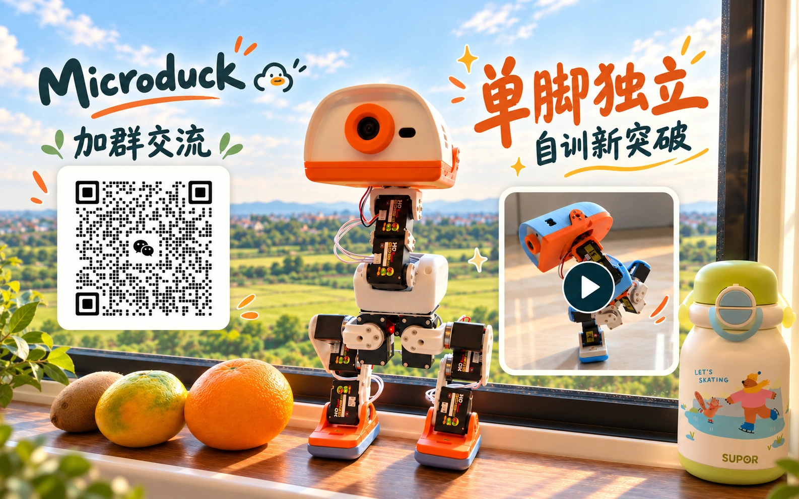

**简体中文** | [English](README.en.md)

# 🦆 Microduck 飞特 HD1910 复刻 · 从零做一只会走的机器人鸭

从零件到一只会走路、会翻跟头的小鸭。基于 [Pollen Robotics Microduck](https://github.com/pollen-robotics/microduck) 完成飞特 HD1910 实机复刻，提供**系统镜像、中文机器人中控、自制 HAT／IMU 与全套 3D 打印件**。

**配套现成动作模型，装好、刷机并完成本机标定后即可体验，无须自己训练。**

<table>
  <tr>
    <td width="50%" align="left"><a href="https://kissqy.github.io/Microduck-kissqy/build/budget.html"><b>① 我要花多少钱？</b></a> 先看各方案参考总额，再看费用明细。</td>
    <td width="50%" align="left"><a href="https://kissqy.github.io/Microduck-kissqy/build/shopping.html"><b>② 我要买什么？</b></a> 按规格、数量和链接，准备采购清单。</td>
  </tr>
  <tr>
    <td align="left"><a href="https://kissqy.github.io/Microduck-kissqy/build/assembly.html"><b>③ 我要怎么装？</b></a> 部位装配、3D 结构与端子接线。</td>
    <td align="left"><a href="https://kissqy.github.io/Microduck-kissqy/build/start.html"><b>④ 我要让鸭子走起来</b></a> 刷机、配网、标定，使用现成模型行走。</td>
  </tr>
</table>

[🚀 从零复刻路线](https://kissqy.github.io/Microduck-kissqy/build/) · [🎮 机器人中控演示](https://kissqy.github.io/Microduck-kissqy/) · [📖 中控使用教程](https://kissqy.github.io/Microduck-kissqy/console-guide.html) · [❓ 常见问题](docs/MICRODUCK-FAQ.md)

## 🏆 单脚独立 · 自训新突破

群二维码在 2026 年 11 月 1 日前有效。

## 🎬 更多实机视频

<table>
<tr>
  <td width="10%"><video src="https://github.com/user-attachments/assets/0ec5b46b-1ec0-483a-a95d-3b3f307e155f" controls></video></td>
  <td width="10%"><video src="https://github.com/user-attachments/assets/d09a6bfe-7a28-4266-ba90-de2b331472ad" controls></video></td>
  <td width="10%"><video src="https://github.com/user-attachments/assets/a604c0e0-af01-413f-ab00-99ccd26db8d5" controls></video></td>
  <td width="10%"><video src="https://github.com/user-attachments/assets/4508d91c-e91c-40f4-8c3e-5ca5a3f959c3" controls></video></td>
  <td width="10%"><video src="https://github.com/user-attachments/assets/fd0dfafd-dd02-4852-940c-33706c287e9d" controls></video></td>
  <td width="10%"><video src="https://github.com/user-attachments/assets/693a3272-d814-42f6-86b3-be5cb3b35b0f" controls></video></td>
</tr>
</table>

[🎬 查看全部实机视频 →](https://kissqy.github.io/Microduck-kissqy/one-leg-balance.html#more-videos)

以上为实机视频；下方中控在线演示使用模拟数据，不连接实机或真正训练。

## ✨ 会走、会翻，还有更多玩法

这是一只会**走路、坐下、捡东西、踢球、前滚翻**的小鸭。装上滑轮，还能探索**对称滑行、蹲下、原地转和倒地起身**等动作。实体手柄就能控制，配套现成模型与中文机器人中控，方便从第一次行走逐步体验更多动作。

**系统镜像 R1 已通过刷卡实测**，预装官方系统、本项目机器人服务和运动模型。刷入 Radxa ZERO 3W、连接 Wi-Fi 后即可打开中文中控，无须自行编译固件。

## 🧭 一条完整制作路线

**[看预算](https://kissqy.github.io/Microduck-kissqy/build/budget.html) → [买齐零件](https://kissqy.github.io/Microduck-kissqy/build/shopping.html) → [装配与接线](https://kissqy.github.io/Microduck-kissqy/build/assembly.html) → [让鸭子走起来](https://kissqy.github.io/Microduck-kissqy/build/start.html)**

每一步先看完整答案，再展开明细；已完成的步骤可以直接跳过。

## 下载与版本

首次制作按 [刷机与首次行走教程](https://kissqy.github.io/Microduck-kissqy/build/start.html) 下载和操作；所需文件就在对应步骤。

[📥 系统镜像 R1](https://kissqy.github.io/Microduck-kissqy/build/start.html#flash) · [📥 机器人中控 R17 V167](https://kissqy.github.io/Microduck-kissqy/build/start.html#connect) · [固件与 IMU 烧录说明](release-assets/README.md)

## 🎮 中文机器人中控

连接与标定鸭子，查看实时 3D 姿态、关节／IMU 反馈和摄像头，使用实体手柄或网页操控，并维护配套固件。

**[在线体验界面](https://kissqy.github.io/Microduck-kissqy/) · [图文使用教程：配网、找 IP、标定与操作](https://kissqy.github.io/Microduck-kissqy/console-guide.html)**

在线演示使用模拟数据。连接实机时下载并运行本地机器人中控。

## 🖨️ 鸭子全套打印件 · 缝合怪版

整合社区优化与作者实机改进，提供**全套结构模型和参考摆盘**。支持普通脚掌与滑轮玩法，方便从打印、装配一路做到实机运行。

[查看打印文件、摆盘预览与装配说明 →](hardware/3d-print-frankenduck/)

## 🔧 HAT 与 IMU 自制记录

自制 HAT 与独立躯干 IMU 已在作者实机上长期使用，提供**电路板工程、材料清单与完整制作记录**。可以自己动手制作，也可选择作者同款成品板。

[硬件工程与制作说明](hardware/README.md) · [IMU 手工制作视频](https://www.bilibili.com/video/BV1qapz6PERs/) · [购买成品板](https://item.taobao.com/item.htm?id=1095121548583)

## ❤️ 分享给大家，也尊重原创

这是作者基于官方 Microduck 完成的个人复刻与开发项目，包含 AI 辅助编程。希望这些资料帮你少走弯路，让自己的小鸭动起来。欢迎 Star ⭐、交流和反馈。[作者的学习记录](docs/AUTHOR-JOURNEY.md)

作者有权授权的原创部分仅供个人学习、研究与非商业使用，商业使用需取得书面授权；官方及第三方内容遵循各自许可。[分项许可](microduck-hd1910/LICENSE) · [个人非商业许可](microduck-hd1910/LICENSES/Personal-NonCommercial.txt) · [第三方说明](microduck-hd1910/docs/THIRD-PARTY.md)

## 🧠 进阶玩法 · 训练自己的动作

已经能稳定使用现成模型后，可以用独立训练中控探索自己的动作：选择任务与配方、观察训练奖励、在仿真中评估，再导出模型进行实机验证。

[训练中控 R1.5.27 指南](microduck-hd1910/training-console/README.zh-CN.md) · [在线演示](https://kissqy.github.io/Microduck-kissqy/training/) · [下载训练中控](https://github.com/kissqy/Microduck-kissqy/raw/refs/heads/main/release-assets/Microduck-Training-Studio-R1.5.27.zip)

<table align="center">
  <tr>
    <td align="center" valign="top" width="50%">
      <b>❤️ 支持作者</b>  
      
    </td>
    <td align="center" valign="top" width="50%">
      <b>💬 联系作者</b>  
       
      微信扫码联系作者。 点击二维码查看原图。
    </td>
  </tr>
</table>
